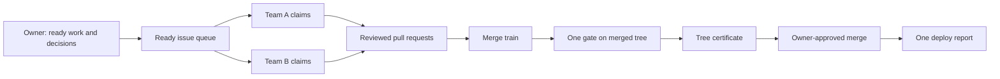
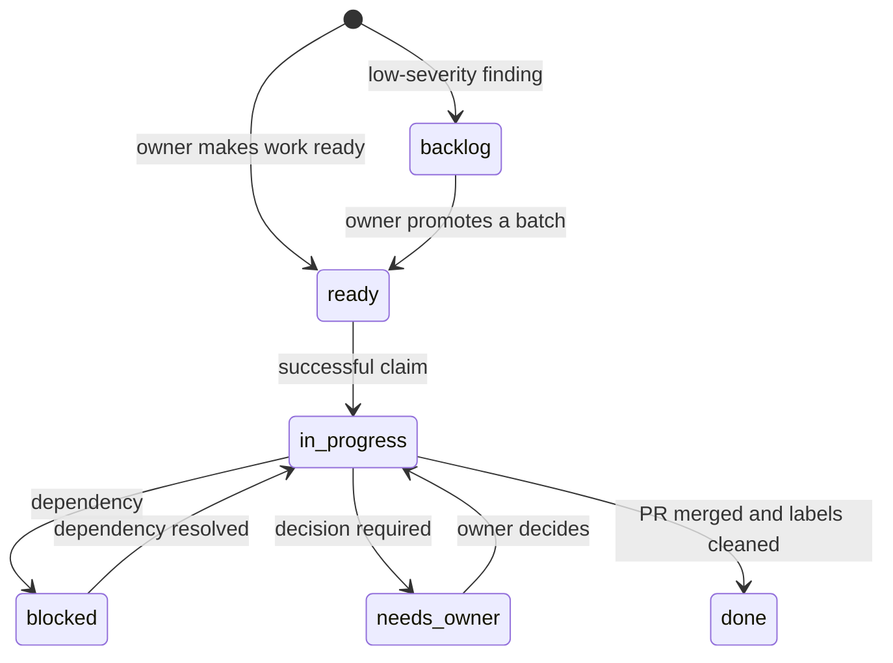
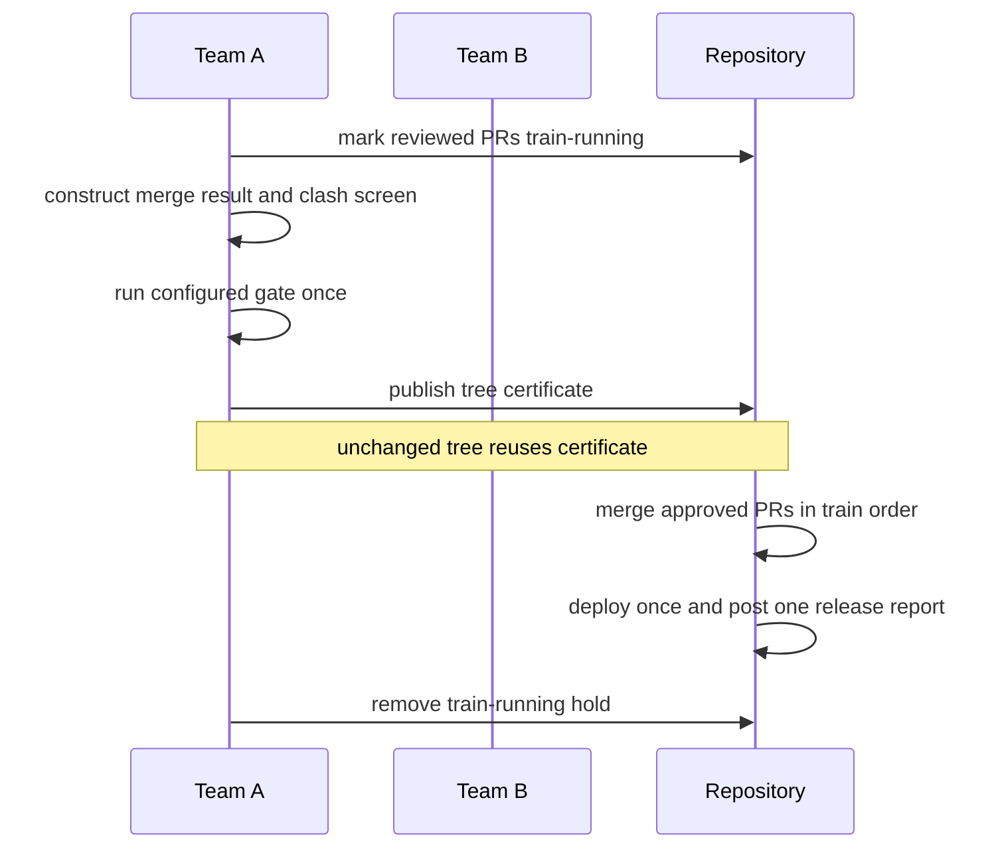
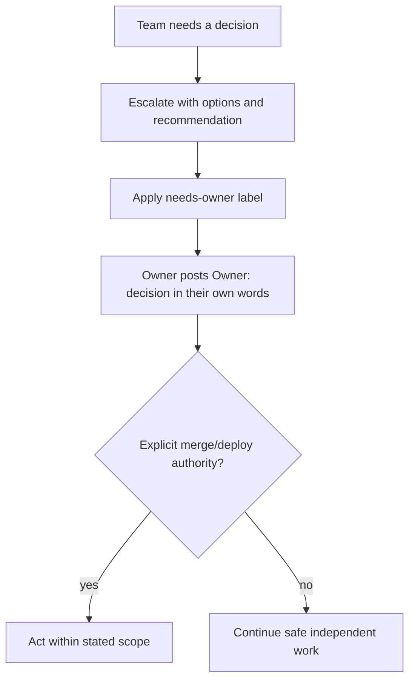
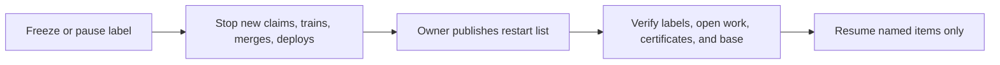

# the-team-loop

`the-team-loop` is a public, MIT-licensed skill for two cooperating AI development teams working in one repository under a human owner's authority. It works with any stack and with or without BMAD.

It turns a common failure mode—two agents independently making, testing, merging, and deploying work—into a small, auditable operating loop:

1. The owner makes work ready and decides merges, deploys, freezes, and mandates.
2. Team A and Team B claim distinct work quickly, post concise status, and review one another where risk warrants it.
3. Reviewed changes board a merge train. One gate validates the train's resulting Git tree.
4. A tree certificate prevents an identical tree being gated again.
5. Deployment is a release event with one report, not a ceremony comment on every PR.

## Why

The loop addresses duplicate claims, lost train runs, repeated expensive tests, unbounded issue creation, ambiguous authority, and noisy coordination. Its defaults are deliberately conservative: only explicit ready work starts, low-severity discoveries enter a backlog, and only the owner can authorize irreversible actions unless an expiring mandate says otherwise.

## Quick start

1. Copy this repository's `skill/the-team-loop/` directory into the repository that will use it.
2. Install an adapter, for example: `./install.sh --tool cursor --target ../my-repo`.
3. Copy `skill/the-team-loop/templates/team-loop.yml` to `.team-loop.yml` and set team names, gate command, and optional deploy command.
4. Create labels: `skill/the-team-loop/scripts/setup-labels.sh --repo OWNER/REPO`.
5. Have the owner create one ready issue and ask each team to follow the installed instructions.

## The process

### Issue lifecycle

### Merge train and certificate

### Owner authority

### Pause and restart

## Roles

| Role | Responsibility |
|---|---|
| Owner | Prioritizes, makes issues ready, gives direct decisions, and grants time-bounded mandates. |
| Team A / Team B | Claim, build, test, review, and report within WIP limits. Names are configurable. |
| Reviewer (optional) | Provides a fresh-context review, especially for risk-tier changes. |

## Labels

| Label | Meaning |
|---|---|
| `ready` | Owner authorizes implementation work. |
| `backlog` | Low-severity findings awaiting a weekly bundle. |
| `team:a`, `team:b`, `team:any` | Route work to a team or either team. |
| `in-progress`, `blocked`, `needs-owner` | Current issue state. |
| `ready-for-owner` | PR has required review and gate evidence. |
| `train-running` | Merge hold while a train is being validated. |
| `freeze` | Stop merges and deploys until the owner restarts work. |
| `deployed` | Work appears in a reported deployment. |

## Rules summary

1. Every change has an issue or PR.
2. Only `ready` issues start work; `backlog` is not a work queue.
3. Claim atomically, then post one short `Status:` claim and plan.
4. Teams do not relay owner decisions. The owner posts `Owner:` in their own words.
5. No ceremony comments; comments communicate a claim, review, gate, hand-off, question, decision, or deploy report.
6. A train holds its included PRs while its base and heads are validated.
7. A gate certifies a Git tree, not a PR number; reuse a valid matching certificate.
8. Merges and deploys require a direct owner go or a scoped, expiring mandate.
9. Deploy once per release and publish one report.
10. During idle time, help reviews, train readiness, or backlog batching—do not run an open-ended bug sweep.

## Metrics and scorecard

Run `skill/the-team-loop/scripts/scorecard.sh --repo OWNER/REPO --since 2026-01-01`. Track gate runs per merged PR, claim latency, issue and PR cycle time, queue net change, mean train size, certified share, and change-failure rate. Definitions and `gh` queries are in [metrics.md](skill/the-team-loop/reference/metrics.md).

## Installation

| Tool | Command |
|---|---|
| Cursor | `./install.sh --tool cursor --target ../my-repo` |
| Claude Code | `./install.sh --tool claude --target ../my-repo` |
| GitHub Copilot | `./install.sh --tool copilot --target ../my-repo` |
| OpenAI Codex | `./install.sh --tool codex --target ../my-repo` |
| Generic | `./install.sh --tool generic --target ../my-repo` |
| All adapters | `./install.sh --tool all --target ../my-repo` |

See [docs/install](docs/install/) for details. The installer is idempotent and supports `--dry-run`.

## Configuration

The checked-in example is [team-loop.yml](skill/the-team-loop/templates/team-loop.yml). Configure the team names, repository, gate command, certificate directory, optional deploy command, WIP limit, and risk paths. The scripts read it through environment variables rather than requiring a YAML parser, so they remain portable.

## BMAD and non-BMAD repositories

The loop maps cleanly to BMAD planning and story roles, but it does not require BMAD. [docs/bmad.md](docs/bmad.md) explains both modes.

## FAQ

**Does this merge or deploy automatically?** No. The scripts prepare and validate a train; the owner remains the authorization boundary.

**What if only one PR is ready?** Gate it as a train of one or use the same gate-and-certificate procedure.

**What if the base changes?** The train is invalid. Reassemble it against the new base and gate the new tree.

**Do both teams need separate GitHub accounts?** Yes, where possible. It makes attribution and review authority verifiable. The protocol still uses explicit headers if identities cannot yet be separated.

## Anti-patterns

- Ready by default floods the queue with speculative follow-ups. Use `backlog` for low-severity findings.
- Open-ended “go ahead” messages are not authority. Require scope and an end time.
- Deploying untested work during critical periods increases change-failure risk. Use a freeze and certificate requirement.
- Relaying an owner decision makes attribution unverifiable. Ask the owner to post it directly.
- Running a full gate for every PR wastes the bottleneck. Gate a reviewed train and reuse matching tree certificates.

## Contributing

See [CONTRIBUTING.md](CONTRIBUTING.md). Changes to the protocol should include a reason, a compatibility note, and updates to the reference material.

## License

MIT. Copyright tjrtm. See [LICENSE](LICENSE).
